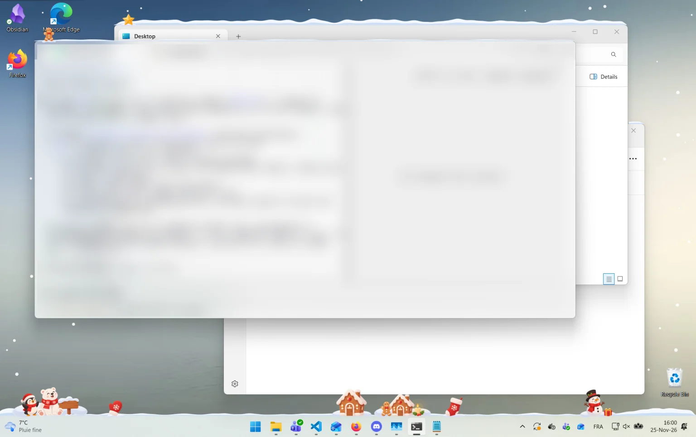
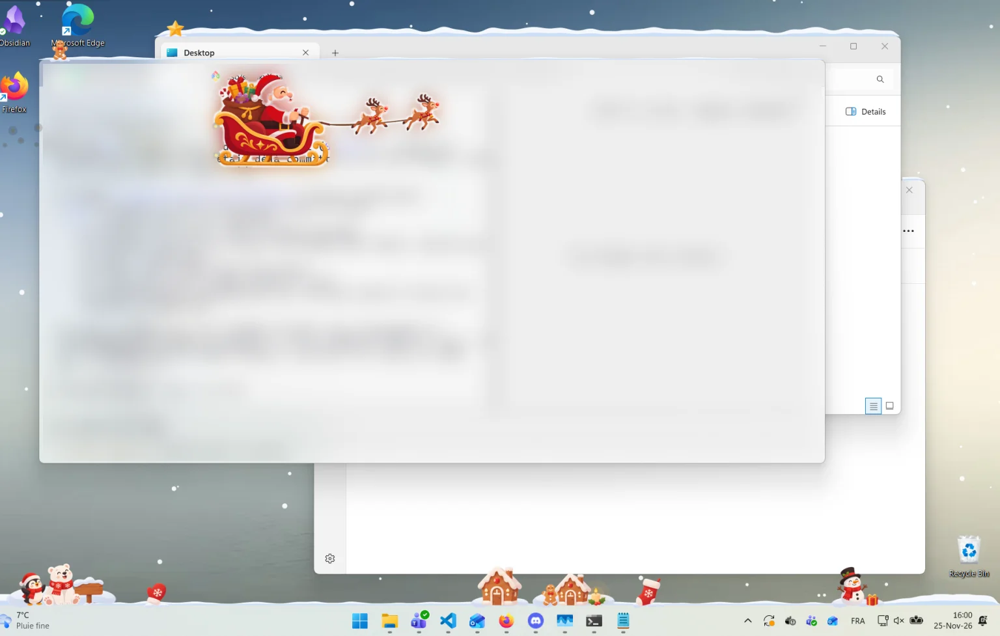
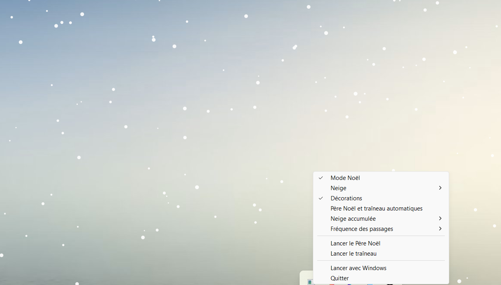

# 🎄 sneakyXmas

[🇫🇷 Français](README.md) · 🇬🇧 English

**Christmas quietly moves into your Windows 11 desktop.**

sneakyXmas is a small resident app that lays a layer of winter magic over your desktop: snow falls and gently piles up on the taskbar and along the top edge of your windows, little Christmas scenes settle in like a miniature village, Santa strolls along the taskbar and his sleigh flies across the screen.

It stays out of your way: clicks go straight through, and as soon as a movie or a game goes fullscreen, everything disappears without disturbing it. ❄️

---

## 📸 Preview



| Santa and his sleigh fly across the screen | The notification area menu |
|---|---|
|  |  |

---

## ✨ What you'll see

- ❄️ **Soft snow** falling over the desktop, never in front of your windows, piling up in rounded little mounds on the taskbar and on top of each window. Move a window and its snow slides off and falls.
- 🏘️ **A village on the taskbar**, laid out like an urban plan: landmarks, groups of three, gaps and clearings. A tree with its lantern and a gingerbread house on the left, a snowman with his gift on the right, and entirely different scenes in between (fireplace, forest, polar corner, gifts, fence…).
- 🎁 **One decoration per window**: each new window gets its own, drawn once and kept for as long as the window exists.
- 🎅 **Santa** walks along the taskbar, stops to wave, then carries on.
- 🦌 **The sleigh and its reindeer** fly across the top of the screen, trailing sparkles.
- 🖥️ **Multiple monitors**: one overlay per screen, and the taskbars of all screens form a single continuous terrain.
- 🎮 **Fullscreen friendly**: a movie or game in fullscreen on one screen hides the overlay on that screen, the others carry on.

## 🎛️ Settings

Right-click the notification area icon:

| Menu | Choices |
|---|---|
| **Christmas mode** | turns everything on or off |
| **Snow** | None · Light · Normal · Heavy |
| **Decorations** | shows or hides the scenes |
| **Automatic Santa and sleigh** | or launched on demand |
| **Accumulated snow** | Thin · Normal · Thick |
| **Frequency of appearances** | Rare · Normal · Frequent |
| **Launch Santa / the sleigh** | a pass right now |
| **Start with Windows** | launch at login |
| **Quit** | |

Settings are saved in `sneakyxmas.ini`, next to the executable. Only one instance runs at a time.

## 🚀 Usage

Run `sneakyxmas.exe`: the icon appears in the notification area and the snow starts falling. No installation, no dependencies.

## 🔧 Building

Requirements: Windows 11, [Rust](https://rustup.rs) with the MSVC toolchain (Visual Studio Build Tools).

```
cargo build --release
```

The executable is produced in `target\release\sneakyxmas.exe`. The images are embedded in the executable.

## 🧩 How it works

- **Overlay**: one transparent, always-on-top, click-through window per screen. Rendered with Direct2D onto a DirectComposition swap chain, at 30 frames per second.
- **Anchors**: the taskbar and every open window are tracked (position, z-order) to attach snow and decorations to them, and to hide them when another window passes in front.
- **Nothing is injected** into Explorer or into your applications: everything is drawn on top.
- Written in Rust, split into modules (`app`, `desktop`, `snow`, `scenes`, `sprites`, `settings`, `tray`).

```
src/
├── main.rs        startup, single instance
├── app/           state, simulation (sim) and drawing (render), one overlay per screen (surface)
├── desktop.rs     windows, anchors, fullscreen
├── snow.rs        flakes, piles, starting layer
├── scenes.rs      scenes, accents, taskbar plan
├── sprites.rs     image loading
├── settings.rs    ini file, start with Windows
└── tray.rs        notification icon and menu
```

## 🗺️ Coming up

- 🔔 A Christmas sound scheme for Windows, with automatic backup and restore of your original sounds.
- ⚙️ More settings.

## 🖼️ Images

The illustrations were AI-generated by the author for personal use and for sharing with friends. They are not free of rights: please do not redistribute them for commercial purposes.

---

*Happy holidays, and may the snow be good!* 🎅❄️🎄
